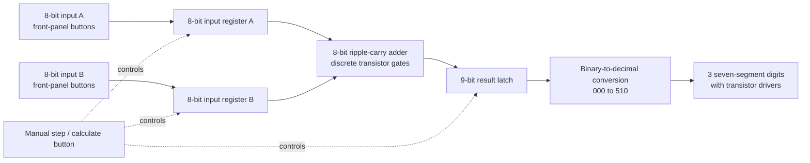

# Zuup Computer: target architecture

The intended machine is a manually operated 8-bit adding computer. The operator enters two 8-bit values with pushbuttons or switches, triggers the calculation, and reads a three-digit decimal result. Logic and storage are made from discrete transistors; there is no microcontroller.

## Display range decision

The adder returns a 9-bit result from 0 through 510 because it adds two unsigned 8-bit values (0 through 255 each). Three decimal digits show 000 through 510. If the intended result should stop at 255, one operand or the arithmetic behavior must change. The first design revision does not yet include the conversion or display decoder.

## Planned KiCad sheets

| Sheet/module | Purpose | Status |
|---|---|---|
| NOR gate | Transistor logic building block | First component-level schematic is included |
| Half adder | Sum and carry for two bits | Planned |
| Full adder | Adds A, B, and carry-in | Planned |
| 8-bit adder | Eight full adders chained by carry | Planned |
| Input registers | Hold two 8-bit numbers | Planned |
| Result latch | Hold the nine result bits for display | Planned |
| Binary-to-decimal | Convert the result to three BCD digits | Planned |
| Seven-segment drivers | Drive three common-anode or common-cathode displays | Planned; display type to be selected before layout |

This staged structure keeps the logic schematic and PCB understandable and makes it possible to test each cell before combining it into the complete machine.
