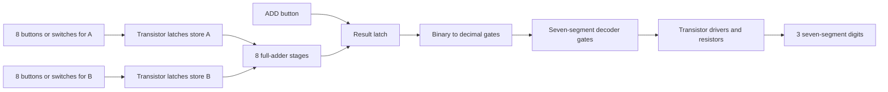

# How Zuup Computer will work

## What the board you have now does

The current board is one tiny logic gate. It does not add numbers or drive a seven-segment display yet. It lets you see how a transistor can act like an on/off switch.

On the board, Q1 and Q2 are two transistor switches. R1 tries to pull output Y up to 5 volts. Pressing the A button sends current through R2 and turns Q1 on; pressing B turns Q2 on. Either transistor can pull Y down to ground. If both buttons are open, R4 and R5 keep the transistor inputs low, both transistors stay off, and R1 pulls Y high.

| A button | B button | Y output | What happens |
|---|---|---:|---|
| Open | Open | 1 | Both transistors off; R1 pulls Y up |
| Pressed | Open | 0 | Q1 turns on and pulls Y down |
| Open | Pressed | 0 | Q2 turns on and pulls Y down |
| Pressed | Pressed | 0 | Both transistors pull Y down |

That rule is called a NOR gate: `Y = NOT (A OR B)`. R2 and R3 limit current into the transistor bases. R4 and R5 hold those bases at a known low level when no button is pressed. The 2N3904 is an NPN transistor that can be used as a switch; its manufacturer datasheet shows the emitter, base, and collector pins. Check that pin order against the part you buy. [onsemi 2N3904 datasheet](https://www.onsemi.com/pdf/datasheet/2n3904-d.pdf)

## How the complete machine can add

The target design takes two 8-bit numbers, stores them, adds them with transistor gates, then shows the answer:



A full-adder stage adds one bit from A, one bit from B, and the carry from the previous bit. It produces a sum bit and a new carry. Eight stages join together so the carry moves from the rightmost bit toward the left.

Example: `5 + 3`

```text
  00000101   5
+ 00000011   3
----------
  00001000   8
```

At the rightmost bit, `1 + 1` makes a `0` and carries a `1` into the next column. That carry continues through the columns until the answer is `00001000`.

## How the display shows the answer

The adder's answer is binary. The display shows decimal, so more transistor logic must first turn the binary answer into three decimal digits. Each digit then needs a decoder that chooses which of its seven LED bars to light. The LED bars need current-limiting resistors and transistor drivers. Seven-segment displays come in common-anode and common-cathode versions, so the exact display must be chosen before drawing that part of the circuit. [Kingbright display catalog](https://www.kingbrightusa.com/webimages/catalog/Whole2.pdf)

Adding two 8-bit values can produce a result from 0 to 510, so three decimal digits are enough; for example, 5 + 3 appears as `008`. This project's display plan uses decimal digits.

## Buttons and memory

A momentary pushbutton only gives a signal while you hold it. The computer needs transistor latches to remember each bit after you let go. The simplest first front panel can use 16 maintained switches (8 for A and 8 for B) plus one ADD button. If you want momentary number buttons, the design needs a latch for every bit, along with clean button timing so one press is read only once.

## Why it has no microcontroller

There is no program stored in a chip. The transistors are wired into logic gates, the gates are wired into adders and memory, and the resistor and transistor network for the display decodes the result. The circuit's connections perform the calculation directly.
